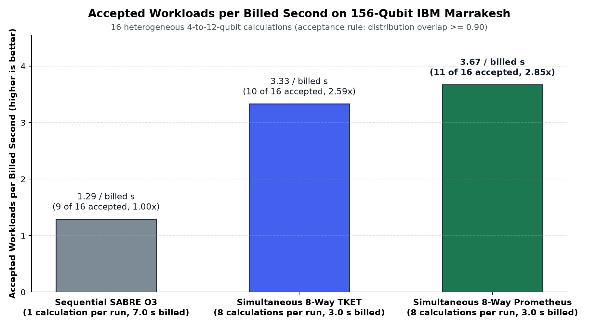

# Parallel Quantum Execution on IBM Hardware

*Explore the portfolio: [Prometheus Quantum Overview](https://github.com/PrometheusDynamicsCanada/prometheus-quantum-overview)*

**Independent quantum calculations can share one processor. We tested whether doing so could deliver more accepted work per billed second.**

Running one small calculation at a time leaves over 90% of a large quantum processor idle while billing for the entire execution window, yet placing circuits directly beside one another introduces crosstalk that degrades accuracy.

Using idle-qubit spacing between up to eight simultaneous calculations on `ibm_marrakesh`, Prometheus delivered **`2.85x` as many qualifying workloads per billed second** (`3.67/s` vs. `1.29/s` for sequential Qiskit SABRE), cutting charged runtime by **`57.1%`** (`3.0 s` vs. `7.0 s`) while keeping neighboring calculations within `-0.0012` to `+0.0035` of isolated same-qubit controls. Supporting multi-compiler and multi-processor selection comparisons are reported separately in [Section 2](#2-supporting-interference--selection-summary-campaigns-1-3).

**[Detailed results](DETAILED_TECHNICAL_REPORT.md) · [Verify the evidence](#verify-the-evidence) · [Discuss a pilot](#discuss-a-pilot)**


*Opening summary (`Campaign 2` & `Campaign 3` dedicated timing-isolation runs on `ibm_marrakesh`, `16` heterogeneous `4Q-12Q` calculations): Simultaneous 8-way simultaneous execution delivered `3.67` accepted calculations per billed second (`11/16` at `F_B >= 0.90` in `3.0 s`) versus `1.29/s` (`9/16` in `7.0 s`) for sequential Qiskit SABRE O3 (`2.85x`).*

---

## 1. Executive Summary & Principal Comparative Benchmark Tables

This repository provides the offline-auditable hardware dataset (`19` live IBM Heron jobs, `586` physical PUBs, `1,140` workload evaluations, `655,360` physical shots, and `220.0` charged QPU seconds) across `ibm_kingston`, `ibm_marrakesh`, and `ibm_fez`. All pre-execution routing, packing, and `(Compiler*, QPU*)` selection decisions were cryptographically locked via SHA-256 commitments prior to hardware submission:
- **Campaign 1 (Uniform 6Q, 8Q, 10Q Cohort, 7 Jobs):** `f0610583e1d56b58006550d36612bfd3fa54481737e77d68ebb1ded995355f6f`
- **Campaign 2 (Heterogeneous 4Q-12Q, 12-Family Cohort, 7 Jobs):** `cfb875e6add9d08372a5dc95ebb1db84bbc52a544464e111ec4e7941903b4f4c`
- **Campaign 3 (Multi-Compiler Joint `(Compiler*, QPU*)` Meta-Selector + 8-Way Packing, 5 Jobs):** `9e3d96c6b0c7a1d7e1475145cf35046e4481c3ac9659edcd8e8b8a3d17c27cc6`

> [!NOTE]
> **Metric Conventions:** Classical Bhattacharyya Distribution Overlap is F_B = Σ_x √(P_ideal(x) · P_meas(x)) (labeled as `"State Fidelity"` in Studio UI screenshots), Squared Hellinger Fidelity is F_H = F_B², and Total Variation Distance is TVD = 0.5 · Σ_x |P_ideal(x) - P_meas(x)|. Direction indicators show `(↑)` higher is better and `(↓)` lower is better; winning values in each comparison are **bolded**.

---

### Table 1A: Dedicated Timing-Isolation & Throughput Benchmarks on `ibm_marrakesh` (16 Heterogeneous Workloads, 4Q-12Q)
*Sample Size: N = 6 dedicated IBM Heron timing jobs (41 PUBs, 41,984 physical shots, 96 circuit executions) on `ibm_marrakesh` across Campaign 2 (T1-T4, 06:06-06:09 UTC) and Campaign 3 (T5-T6, 15:10 UTC).*

| Timing-Isolation Arm (`ibm_marrakesh`) | Job ID (Window) | PUBs / Shots `(↓)` | Active Exec / Billed Time `(↓)` | Overlap F_B *(mean / med)* `(↑)` | Hellinger F_H *(mean)* `(↑)` | TVD *(mean)* `(↓)` | Qualified (F_B ≥ 0.80 / 0.85 / 0.90) `(↑)` | Qualified (F_B ≥ 0.90) per Billed s / Exec s `(↑)` |
| :--- | :--- | :---: | :---: | :---: | :---: | :---: | :---: | :---: |
| **T1: Qiskit SABRE O3 Sequential** (1 circ/PUB, 12Q max) | `dbk2gr1kdqps7391kq90` (C2) | 16 / 16,384 | 4.4424s / 7.0s | 0.8593 / 0.9062 | 0.7557 | 0.2945 | 12 / 11 / 9 (of 16) | 1.29/s (1.00x) \| 2.03/s (1.00x) |
| **T2: Prometheus Sequential** (1 circ/PUB, 12Q max) | `dbk2hf9kdqps7391krmg` (C2) | 16 / 16,384 | 4.3905s / 7.0s | **0.8840** / 0.9280 | **0.7986** | **0.2489** | **12 / 12 / 11** (of 16) | 1.57/s (1.22x) \| 2.51/s (1.24x) |
| **T3: Prometheus 3-PUB Packed** (k=5,5,6, 42Q, Policy A) | `dbk2hkl6p51s73clr60g` (C2) | 3 / 3,072 | 0.8451s / **3.0s** | 0.8838 / 0.9365 | 0.7981 | 0.2494 | **12 / 12 / 11** (of 16) | **3.67/s (2.85x)** \| 13.02/s (6.42x) |
| **T4: Prometheus 2-PUB Packed** (k=8,8, 62Q, Policy A) | `dbk2i1d6p51s73clr6ug` (C2) | **2 / 2,048** | **0.5663s (7.84x)** / **3.0s (-57.1%)** | 0.8837 / **0.9396** | 0.7976 | 0.2560 | **12 / 12 / 11** (of 16) | **3.67/s (2.85x)** \| **19.42/s (9.59x)** |
| **T5: Quantinuum TKET 2-PUB Packed** (k=8,8, 62Q, Policy A) | `dbkafj1kdqps739235eg` (C3) | **2 / 2,048** | 0.5782s (7.68x) / **3.0s (-57.1%)** | 0.8542 / 0.9302 | 0.7548 | 0.2938 | 11 / 11 / 10 (of 16) | 3.33/s (2.59x) \| 17.30/s (8.54x) |
| **T6: Prometheus Meta-Selector 2-PUB** (k=8,8, 62Q, Policy A) | `dbkaflhkdqps739235hg` (C3) | **2 / 2,048** | 0.5780s (7.69x) / **3.0s (-57.1%)** | **0.8634 (+1.08% vs T5)** / 0.9282 | **0.7686 (+1.83%)** | **0.2801 (-4.6%)** | **12** / 11 / **11** (of 16) | **3.67/s (2.85x)** \| 19.03/s (9.39x) |

### Table 1B: Campaign 1 Dedicated Timing-Isolation & Throughput Benchmark on `ibm_kingston` (12 Uniform Workloads, 6Q-10Q)
*Sample Size: N = 4 dedicated IBM Heron timing jobs (29 PUBs, 29,696 physical shots, 48 circuit executions) on `ibm_kingston`.*

| Timing-Isolation Arm (`ibm_kingston`) | IBM Job ID | PUBs / Shots `(↓)` | Active Exec / Billed Time `(↓)` | Overlap F_B *(mean / med)* `(↑)` | Hellinger F_H *(mean)* `(↑)` | TVD *(mean)* `(↓)` | Qualified (F_B ≥ 0.80 / 0.85 / 0.90) `(↑)` | Qualified (F_B ≥ 0.90) per Billed s / Exec s `(↑)` |
| :--- | :--- | :---: | :---: | :---: | :---: | :---: | :---: | :---: |
| **T1: Qiskit SABRE O3 Sequential** (1 circ/PUB, 10Q max) | `dbk1i3l6p51s73clp22g` | 12 / 12,288 | 3.2775s / 6.0s | 0.8940 / 0.9203 | 0.8067 | 0.2880 | 10 / 9 / 7 (of 12) | 1.17/s (1.00x) \| 2.14/s (1.00x) |
| **T2: Prometheus Sequential** (1 circ/PUB, 10Q max) | `dbk1i6t6p51s73clp290` | 12 / 12,288 | 3.2736s / 5.0s | **0.9179** / 0.9380 | **0.8467** | **0.2348** | **11 / 10** / 8 (of 12) | 1.60/s (1.37x) \| 2.44/s (1.14x) |
| **T3: Prometheus 3-PUB Packed** (k=4,4,4, 32Q, frozen spacing policy) | `dbk1ia1kdqps7391ikgg` | 3 / 3,072 | 0.8294s / **3.0s** | 0.9108 / **0.9443** | 0.8352 | 0.2520 | 10 / 10 / 8 (of 12) | 2.67/s (2.29x) \| 9.65/s (4.52x) |
| **T4: Prometheus 2-PUB Packed** (k=6,6, 48Q, frozen spacing policy) | `dbk1ic9ffo6c73baki30` | **2 / 2,048** | **0.5560s (5.89x)** / **3.0s (-50.0%)** | 0.9157 / 0.9419 | 0.8434 | 0.2428 | 10 / 10 / **9** (of 12) | **3.00/s (2.57x)** \| **16.19/s (7.58x)** |

---

## 2. Supporting Interference & Selection Summary (`Campaigns 1-3`)

Full 3-processor interleaved interference tables (`Tables 2A-2C`), the 9-way vs. independent `Arm 6` selection comparison (`Tables 3A-3C`: `0.894375` selected-outcome mean vs. `0.893921` strongest fixed policy vs. `0.893004` independent `Arm 6` selector execution), and the complete 19-job `220.0 s` hardware ledger (`Table 4`) are documented in [`DETAILED_TECHNICAL_REPORT.md`](DETAILED_TECHNICAL_REPORT.md).

---

## Verify the Evidence

**Verification Kind:** Direct **raw-measurement histogram reconstruction** (`numpy` only, zero cloud credentials). Verifies pre-execution SHA-256 commitments (`f0610583...`, `cfb875e6...`, `9e3d96c6...`) and recomputes all `1,140` workload evaluations (`1,194` component executions) from raw per-PUB bitstring histograms in `data/*/jobs/*.json` (`max |Delta F_B| = 0.00e+00`):

```bash
python scripts/verify_spatial_multiplexing_campaigns.py
```

- **Key files:** [`DETAILED_TECHNICAL_REPORT.md`](DETAILED_TECHNICAL_REPORT.md) · [`data/ALL_19_IBM_HERON_JOBS_LEDGER.csv`](data/ALL_19_IBM_HERON_JOBS_LEDGER.csv) · [`PUBLIC_DISCLOSURE.md`](PUBLIC_DISCLOSURE.md) · [`REPOSITORY_SHA256SUMS.txt`](REPOSITORY_SHA256SUMS.txt)

---

## Discuss a Pilot

**Bring a representative workload and an acceptance criterion. We can compare Prometheus with your existing execution approach and measure quality, acceptance rate and charged hardware resources.**

- **Contact:** [william@prometheusdynamics.ca](mailto:william@prometheusdynamics.ca) | [prometheusdynamics.ca](https://prometheusdynamics.ca)
